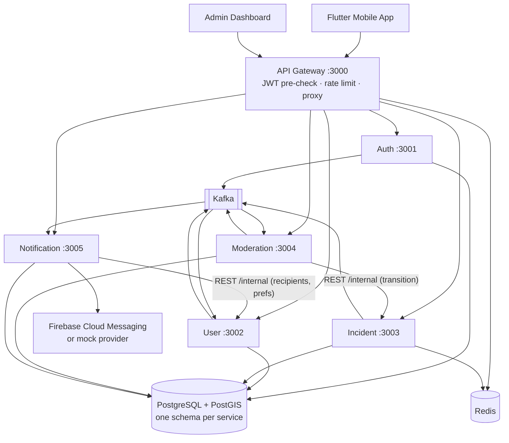

# Urban Alert Platform — Backend

**App Cảnh Báo Đô Thị**: a platform for reporting and alerting on traffic and urban incidents in Vietnam
(accidents, traffic jams, flooding, road closures, construction).

Users report incidents with a location, description, and media. Moderators verify them, and verified
incidents trigger push alerts to users who follow the surrounding area.

This repository contains the **backend foundation**: a NestJS microservice monorepo, local
infrastructure, the database schema, event contracts, and service skeletons with the core flows
implemented end to end. See [Known limitations](#known-limitations--next-steps) for what is not built yet.

---

## Tech stack

| Component | Technology (pinned version) |
|---|---|
| Runtime | Node.js 22 LTS (`.nvmrc`) |
| Language | TypeScript 5.9 (strict) |
| Framework | NestJS 11.2 (monorepo mode, webpack builds) |
| Package manager | Yarn 1.22 (classic, `packageManager` field) |
| API | REST, URI-versioned (`/api/v1`), Swagger / OpenAPI (`@nestjs/swagger` 11) |
| Database | PostgreSQL 16 + PostGIS 3.5 |
| ORM | Prisma 6.19 |
| Messaging | Apache Kafka 3.9 (official `apache/kafka` image, KRaft) via `kafkajs` 2.2 |
| Cache / rate limit | Redis 7.4 via `ioredis` 5 |
| Auth | JWT (`@nestjs/jwt`), Argon2id password hashing (`argon2`) |
| Validation | `class-validator` / `class-transformer` |
| Logging | Pino (`nestjs-pino`, `pino-http`) |
| Health | `@nestjs/terminus` |
| Testing | Jest 30 + ts-jest, `light-my-request` for in-process HTTP tests |
| Lint / format | ESLint 10 + typescript-eslint, Prettier 3 |
| Infrastructure | Docker Compose |

**Why NestJS 11 and not 12?** NestJS 12 was released in late October 2026 and is ESM-only. NestJS 11
is still maintained, uses CommonJS, and is compatible with the rest of the ecosystem (Prisma 6,
kafkajs, Terminus). Upgrading is a separate, deliberate step. See
[ADR-001](docs/architecture/architecture-decisions.md#adr-001-nestjs-11-monorepo-node-22-yarn).

## Architecture



- Only the gateway is public. It forwards `/api/v1/<service>/*` unchanged to the owning service.
- Each service owns one PostgreSQL schema and connects with a role that can only access that schema.
- Synchronous calls between services use `/internal/*` REST routes protected by a shared API key.
  The gateway never exposes these routes.
- Events are delivered through Kafka at least once, with retries, dead-letter topics, and idempotent consumers.

More detail:

- [System overview](docs/architecture/system-overview.md)
- [Architecture decisions](docs/architecture/architecture-decisions.md)
- [Database design](docs/database/database-design.md)
- [Event catalog](docs/events/event-catalog.md)
- [API overview](docs/api/api-overview.md)
- [Development guide](docs/development/development-guide.md)

## Repository structure

```text
apps/
  api-gateway/            reverse proxy, JWT pre-check, Redis rate limit, aggregated Swagger
  auth-service/           register, login, refresh rotation, logout, /auth/me
  user-service/           profiles, saved areas, notification preferences, alert-recipient matching
  incident-service/       incidents, PostGIS queries, lifecycle state machine, history, events
  moderation-service/     review queue, approve/reject/request-info, duplicate hints
  notification-service/   Kafka-driven notifications, push adapter (FCM / mock)
libs/
  common/                 exceptions, error filter, response envelope, guards, decorators,
                          validation pipe, correlation id, internal HTTP client, bootstrap
  config/                 validated, typed per-service configuration
  contracts/              shared enums, event envelope and payload types, API types
  database/               PrismaService, DB health indicator, PostGIS SQL helpers
  kafka/                  typed publisher, consumer with retry + DLT, health indicator
  redis/                  Redis client, JSON cache, health indicator
  observability/          pino logging setup, health endpoints module
prisma/
  schema.prisma           single schema, multi-schema (auth, users, incidents, moderation, notifications)
  migrations/             hand-reviewed SQL migrations (PostGIS, location triggers, CHECKs)
  seed.ts                 development seed data
infrastructure/
  docker/Dockerfile       per-service image (build arg APP)
  postgres/init/          creates per-service schemas and least-privileged roles
  kafka/                  topic list and topic creation script
  scripts/verify-infra.sh infrastructure health/provisioning checks
docs/                     architecture, API, database, events, development guides
test/                     shared test utilities and integration test config
docker-compose.yml        Postgres+PostGIS, Redis, Kafka (KRaft), kafka-init, Kafka UI
```

## Prerequisites

- **Node.js 22 LTS**. Run `nvm use` to pick up `.nvmrc`.
- **Yarn 1.22** (classic): `npm i -g yarn` or `brew install yarn`.
- **Docker** with Compose v2 (Docker Desktop, OrbStack, or Colima).
- About 3 GB of free RAM for Kafka, Postgres, and the six services.

## Getting started

```bash
# 1. Install dependencies
yarn install

# 2. Configure the environment (local development defaults)
cp .env.example .env

# 3. Start infrastructure and check it
docker compose up -d
yarn infra:verify

# 4. Database
yarn prisma:generate
yarn prisma:migrate     # applies prisma/migrations (prisma migrate dev)
yarn prisma:seed

# 5. Run all services in watch mode
yarn dev
```

### Environment

`.env.example` documents every variable. Highlights:

- `MIGRATION_DATABASE_URL`: the owner role. The Prisma CLI uses it for migrations and seeding.
- `<SERVICE>_DATABASE_URL`: the least-privileged role for each service. In containers you can set
  `DATABASE_URL` / `PORT` instead; the prefixed form wins when both are set.
- `JWT_ACCESS_SECRET` (at least 32 characters) and `INTERNAL_API_KEY` (at least 16 characters) are
  required. Every service validates its configuration at startup and refuses to boot when it is invalid.
- `FCM_*`: leave these empty to use the mock push provider, which logs instead of sending.

Never reuse the `.env.example` values outside local development.

### Running services

| Service | Port | Command |
|---|---|---|
| api-gateway | 3000 | `yarn dev:api-gateway` |
| auth-service | 3001 | `yarn dev:auth-service` |
| user-service | 3002 | `yarn dev:user-service` |
| incident-service | 3003 | `yarn dev:incident-service` |
| moderation-service | 3004 | `yarn dev:moderation-service` |
| notification-service | 3005 | `yarn dev:notification-service` |

`yarn dev` starts all six with `concurrently`.

Production-style run:

```bash
yarn build
APP=incident-service yarn start:prod
```

### Useful URLs

| What | URL |
|---|---|
| Gateway (public API) | http://localhost:3000/api/v1 |
| Swagger, all services | http://localhost:3000/docs (use the selector at the top right) |
| Swagger for one service | `http://localhost:<port>/docs` (JSON at `/docs-json`) |
| Gateway readiness | http://localhost:3000/health |
| Downstream status | http://localhost:3000/health/services |
| Kafka UI | http://localhost:8080 |

### Seed accounts (DEV ONLY)

| Email | Role | Password |
|---|---|---|
| `admin@urbanalert.local` | ADMIN | `Password123` |
| `moderator@urbanalert.local` | MODERATOR | `Password123` |
| `user@urbanalert.local` | USER | `Password123` |

## Quality checks

```bash
yarn lint              # ESLint
yarn format:check      # Prettier
yarn typecheck         # tsc --noEmit over the whole monorepo
yarn test              # unit + in-process HTTP tests (no infrastructure needed)
yarn test:cov          # with coverage
yarn test:integration  # needs docker compose up + migrated database
yarn build             # webpack build of all six apps into dist/apps/*
```

## Troubleshooting

| Symptom | Fix |
|---|---|
| Services log `Kafka consumer failed to start` or topics are missing | Kafka can take 20–40 s to become healthy. Check `docker compose ps` and `docker compose logs kafka-init`. Re-create topics with `docker compose run --rm kafka-init`. Consumers retry every 5 s. |
| `permission denied for schema …` or role login fails | The Postgres init script only runs on an **empty** volume. Re-apply it: `docker compose exec -T postgres bash /docker-entrypoint-initdb.d/20-roles-and-schemas.sh` |
| `no matching manifest for linux/arm64` or PostGIS is slow on Apple Silicon | `postgis/postgis` is amd64-only; Compose runs it with `platform: linux/amd64` (Rosetta). For a native arm64 image set `POSTGIS_IMAGE=imresamu/postgis:16-3.5` and `POSTGIS_PLATFORM=linux/arm64` in `.env`. |
| Port already in use | Override `POSTGRES_PORT`, `REDIS_PORT`, `KAFKA_PORT`, `KAFKA_UI_PORT`, or `<SERVICE>_PORT` in `.env`. If you change a service port, update the matching `*_SERVICE_URL`. |
| `Invalid environment configuration` at startup | A required variable is missing or invalid. The message names it. Compare against `.env.example`. |
| Start over with clean data | `docker compose down -v`, then `docker compose up -d` and re-run the migrate and seed steps |
| `prisma migrate dev` reports drift or creates an unexpected migration | Do not apply it. Delete the new folder in `prisma/migrations/` and see [Database design → Migrations](docs/database/database-design.md#migrations). |
| `permission denied` in services after `prisma migrate reset` | Resetting drops the service schemas and their grants. Run `yarn db:grants`, or use `yarn db:reset`, which does both. |

## Known limitations / next steps

These are deliberately out of scope for the foundation:

- **Transactional outbox.** Events are published after the database commit. A crash between the
  commit and the publish loses the event (logged). See ADR-007.
- **Notification retry sweeper.** Notifications left `PENDING` after a crash (between commit and
  push) are not retried yet.
- **Incident confirmations.** The `IncidentReport` model exists, and the original report is stored,
  but there is no endpoint yet for other users to confirm or update an incident.
- **Media upload.** Incidents accept HTTPS URLs of already-uploaded media. There is no upload or
  signed-URL service yet.
- **Token signing.** Access tokens use a shared HS256 secret. Moving to RS256 with JWKS would let
  services verify tokens without holding the signing key.
- **Moderation case sync.** If a moderator or admin changes an incident's status directly with
  `PATCH /incidents/:id`, the moderation case is not updated.
- **Application containers.** `infrastructure/docker/Dockerfile` builds service images, but
  `docker-compose.yml` runs only the infrastructure.
- **Production hardening.** Deployment, secrets management, TLS, Kafka authentication, and
  multi-broker replication are not covered.
