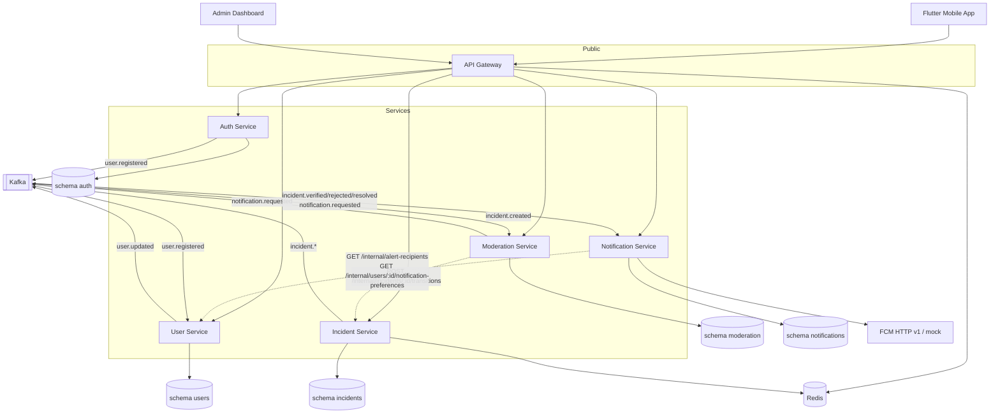
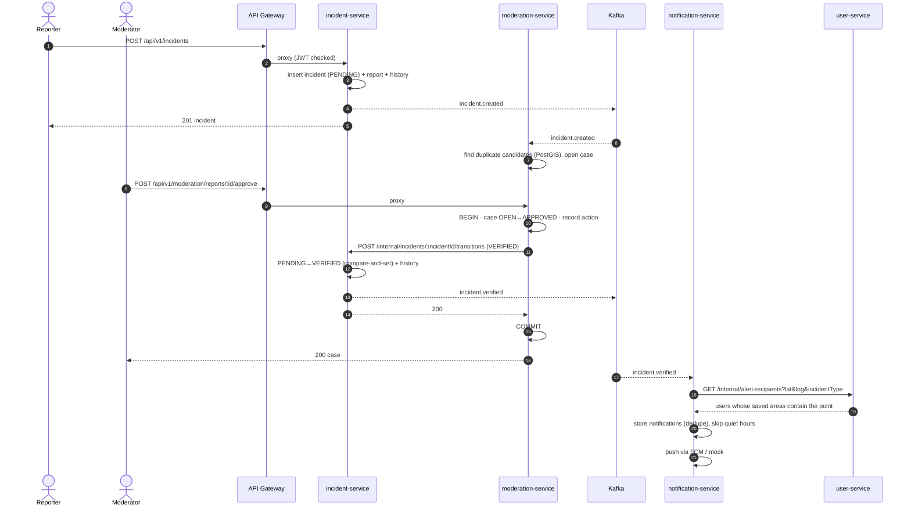

# System Overview

## Architecture

All five schemas live in a single PostgreSQL + PostGIS instance. See [Database ownership](#database-ownership).

## Service responsibilities

| Service | Port | Owns | Responsibilities |
|---|---|---|---|
| **api-gateway** | 3000 | none (Redis keys) | Public entry point. Correlation id, access logging, Redis rate limiting, JWT pre-validation, reverse proxy to services, aggregated Swagger, health. No business logic. |
| **auth-service** | 3001 | `auth` | Registration, login (Argon2id), access token issuance, refresh-token rotation with reuse detection, logout, `GET /auth/me`. Publishes `user.registered`. |
| **user-service** | 3002 | `users` | Profiles, saved areas (PostGIS), notification preferences. Internal API to match users whose saved areas contain a point. Consumes `user.registered`, publishes `user.updated`. |
| **incident-service** | 3003 | `incidents` | Incident reports, media references, list, bounding-box and radius queries, the status state machine, history, Redis detail cache. The **only** producer of `incident.*` events. |
| **moderation-service** | 3004 | `moderation` | Review queue built from `incident.created`, rule-based duplicate hints, approve/reject/request-info with an audit log. Applies decisions through incident-service's internal API. |
| **notification-service** | 3005 | `notifications` | Consumes incident and notification events, finds recipients, stores in-app notifications, sends pushes through an adapter (FCM or mock), registers device tokens. |

Shared libraries (`libs/*`) hold technical building blocks and contracts only. No service's business
logic lives in a library.

## Communication patterns

### 1. Client → gateway → service (synchronous REST)

The gateway is a **passthrough reverse proxy** (`http-proxy-middleware`). `/api/v1/<prefix>/*` is
forwarded with the path unchanged, because every service uses the same `/api/v1` prefix. Before
proxying, the gateway:

1. assigns or propagates `x-correlation-id`;
2. logs the request (pino);
3. applies a per-IP fixed-window rate limit (Redis, fails open);
4. verifies the bearer token. Protected routes without a token get 401, and any invalid token gets
   401. Public routes are listed in `apps/api-gateway/src/proxy/routes.ts`.

Request bodies are not parsed at the gateway. Each service validates its own DTOs and enforces its
own authorization, verifying the same JWT again as defense in depth.

### 2. Service → service (synchronous REST, `/internal/*`)

Used only when the caller needs an immediate answer:

| Caller | Callee | Route | Why synchronous |
|---|---|---|---|
| moderation | incident | `POST /internal/incidents/:id/transitions` | The moderator needs to know the decision was applied. Incident-service owns the state. |
| notification | user | `GET /internal/alert-recipients` | Needs the current saved areas and preferences to fan out an alert. |
| notification | user | `GET /internal/users/:id/notification-preferences` | Read-through for `GET /notifications/preferences`. |

Internal routes sit outside the `/api/v1` prefix, are excluded from Swagger, require the shared
`x-internal-api-key` header (compared in constant time), and are never routed by the gateway. The
`InternalHttpClient` (in `libs/common`) propagates the correlation id, applies a 5-second timeout,
and maps callee errors back to the standard error format.

### 3. Asynchronous events (Kafka)

Facts that other services react to on their own schedule go through Kafka. Delivery is at least
once, with in-process retries, a dead-letter topic per topic, and idempotent consumers. See the
[event catalog](../events/event-catalog.md).

## Core flow: report → moderate → verify → notify

Rejection works the same way: `incident.rejected`, with a mandatory reason, notifies the reporter.
Request-info publishes `notification.requested` to the reporter.

## Database ownership

One PostgreSQL instance and one schema per service:

| Schema | Owner service | DB role |
|---|---|---|
| `auth` | auth-service | `auth_service` |
| `users` | user-service | `user_service` |
| `incidents` | incident-service | `incident_service` |
| `moderation` | moderation-service | `moderation_service` |
| `notifications` | notification-service | `notification_service` |

Each role has `SELECT/INSERT/UPDATE/DELETE` on its own schema only. A query against another
service's tables fails with `permission denied`. Migrations run as the owner role. There are no
foreign keys across schemas; services reference each other by id and keep the copies they need
(for example, moderation cases copy the incident's type and location). Details:
[database design](../database/database-design.md).

## External integrations

| Integration | Implementation | Local behavior |
|---|---|---|
| Firebase Cloud Messaging | `FcmPushProvider`: HTTP v1 API with a service-account OAuth JWT signed by `node:crypto`. No Firebase SDK. | When `FCM_PROJECT_ID`, `FCM_CLIENT_EMAIL`, and `FCM_PRIVATE_KEY` are not all set, `MockPushProvider` logs pushes instead. |
| Media storage | Not implemented. Incidents accept HTTPS URLs. | — |

## Cross-cutting concerns

- **Correlation id**: the `x-correlation-id` header is accepted when well formed, otherwise
  generated. It is echoed in responses, included in every log line and error body, forwarded on
  internal calls, and carried in every event envelope.
- **Logging**: pino JSON, with pretty output when `LOG_PRETTY=true`. Authorization headers,
  passwords, tokens, and private keys are redacted.
- **Errors and responses**: one envelope for every service. See the [API overview](../api/api-overview.md).
- **Health**: `GET /health/live` (liveness) and `GET /health` (readiness: the database, plus Kafka
  for notification-service and Redis for the gateway).
- **Graceful shutdown**: Nest shutdown hooks close the Kafka consumer (after in-flight messages
  finish), the producer, Redis, and Prisma.
