# Database Design

- **Engine:** PostgreSQL 16 + PostGIS 3.5, one instance.
- **ORM:** Prisma 6.19, one schema file (`prisma/schema.prisma`) and one migration history (`prisma/migrations`).
- **Ids:** UUID (`@db.Uuid`, generated by Prisma).
- **Time:** `timestamptz(3)` everywhere, stored in UTC. The container runs with `TZ=UTC`, and APIs
  return ISO 8601 UTC strings.

## Ownership and isolation

| Schema | Service | Login role | Tables |
|---|---|---|---|
| `auth` | auth-service | `auth_service` | `users`, `refresh_tokens` |
| `users` | user-service | `user_service` | `profiles`, `saved_areas`, `notification_preferences`, `processed_events` |
| `incidents` | incident-service | `incident_service` | `incidents`, `incident_reports`, `incident_media`, `incident_history` |
| `moderation` | moderation-service | `moderation_service` | `cases`, `actions`, `processed_events` |
| `notifications` | notification-service | `notification_service` | `notifications`, `device_tokens`, `processed_events` |

`infrastructure/postgres/init/20-roles-and-schemas.sh` runs on the first container start and is
idempotent. It:

- creates the `postgis` extension and revokes `CREATE` on `public`;
- creates each schema, owned by `$POSTGRES_USER` (the migration and owner role);
- creates each `<service>_service` role (`NOSUPERUSER NOCREATEDB NOCREATEROLE`, `search_path = <schema>, public`);
- grants `USAGE` on the role's own schema plus `SELECT, INSERT, UPDATE, DELETE` on its tables and sequences;
- sets `ALTER DEFAULT PRIVILEGES` so that tables created later by migrations inherit the grants.

Services cannot run DDL or read other schemas. **There are no cross-schema foreign keys.**
References between services are plain UUID columns (`reporter_id`, `user_id`, `incident_id`, …).
Data that another service needs is copied through events; for example, `moderation.cases` copies
the incident type, title, and location.

To re-apply the grants on an existing volume:

```bash
docker compose exec -T postgres bash /docker-entrypoint-initdb.d/20-roles-and-schemas.sh
```

## Entity relationships

Solid lines are real foreign keys (inside one schema). The text after each relationship says how
the other side references it; "by id" marks references by id only.

```mermaid
erDiagram
    %% auth
    AUTH_USERS ||--o{ REFRESH_TOKENS : "has"
    AUTH_USERS {
        uuid id PK
        varchar email UK
        text password_hash
        enum role "USER|MODERATOR|ADMIN"
    }
    REFRESH_TOKENS {
        uuid id PK
        uuid user_id FK
        uuid family_id
        char64 token_hash UK
        timestamptz expires_at
        timestamptz revoked_at
        uuid replaced_by_id
    }

    %% users
    PROFILES ||--o{ SAVED_AREAS : "has"
    PROFILES ||--o| NOTIFICATION_PREFERENCES : "has"
    PROFILES {
        uuid id PK "= auth.users.id (by id)"
        varchar email
        varchar display_name
        varchar avatar_url
        varchar locale
    }
    SAVED_AREAS {
        uuid id PK
        uuid user_id FK
        varchar name
        float latitude
        float longitude
        geography location "set by trigger"
        int radius_meters
    }
    NOTIFICATION_PREFERENCES {
        uuid user_id PK
        bool push_enabled
        text_array incident_types
        smallint quiet_hours_start
        smallint quiet_hours_end
    }

    %% incidents
    INCIDENTS ||--o{ INCIDENT_REPORTS : "has"
    INCIDENTS ||--o{ INCIDENT_MEDIA : "has"
    INCIDENTS ||--o{ INCIDENT_HISTORY : "has"
    INCIDENTS {
        uuid id PK
        uuid reporter_id "by id"
        enum type
        varchar title
        text description
        float latitude
        float longitude
        geography location "set by trigger"
        enum status
        timestamptz occurred_at
    }
    INCIDENT_REPORTS {
        uuid id PK
        uuid incident_id FK
        uuid reporter_id
        enum status "PENDING|ACCEPTED|REJECTED"
    }
    INCIDENT_MEDIA {
        uuid id PK
        uuid incident_id FK
        varchar media_url
        enum media_type "IMAGE|VIDEO"
    }
    INCIDENT_HISTORY {
        uuid id PK
        uuid incident_id FK
        uuid actor_id
        enum action "CREATED|UPDATED|STATUS_CHANGED"
        enum previous_status
        enum new_status
        jsonb metadata
    }

    %% moderation
    CASES ||--o{ ACTIONS : "has"
    CASES {
        uuid id PK
        uuid incident_id UK "by id"
        uuid reporter_id
        varchar incident_type
        geography location "set by trigger"
        enum status "OPEN|INFO_REQUESTED|APPROVED|REJECTED"
        uuid_array possible_duplicate_ids
    }
    ACTIONS {
        uuid id PK
        uuid case_id FK
        uuid moderator_id
        enum action "APPROVE|REJECT|REQUEST_INFO"
        text reason
    }

    %% notifications
    NOTIFICATIONS {
        uuid id PK
        uuid user_id "by id"
        enum type
        varchar title
        text body
        jsonb data
        enum status "PENDING|SENT|FAILED|SKIPPED"
        varchar dedupe_key
        timestamptz read_at
    }
    DEVICE_TOKENS {
        uuid id PK
        uuid user_id "by id"
        varchar token UK
        varchar platform
    }
```



Each consuming schema (`users`, `moderation`, `notifications`) also has a `processed_events` table
(`event_id` PK, `event_type`, `processed_at`) for idempotent Kafka consumption.

### Deviation from the initial model

The initial spec listed one `User` with `displayName`. It is split into `auth.users` (credentials,
role) and `users.profiles` (display data). See ADR-013. `Notification` adds `data`, `status`,
`dedupe_key`, and `sent_at`. `RefreshToken` adds `family_id` and `replaced_by_id` for rotation.

## PostGIS design

| Aspect | Choice |
|---|---|
| SRID | 4326 (WGS84 latitude/longitude) |
| Type | `geography(Point,4326)`, so distances and radii are in **metres** on the spheroid |
| Writes | Apps write `latitude`/`longitude`. A `BEFORE INSERT OR UPDATE OF latitude, longitude` trigger (`<schema>.sync_location()`) sets `location = ST_SetSRID(ST_MakePoint(longitude, latitude), 4326)::geography` |
| Prisma | `location Unsupported("geography(Point,4326)")?`, which Prisma never reads or writes |
| Indexes | GiST on `incidents.incidents.location`, `users.saved_areas.location`, `moderation.cases.location` |
| Queries | `$queryRaw` with bound parameters; helpers `geographyPoint()` and `envelope()` in `libs/database/src/geo.ts` |

Queries (filtering always runs in PostgreSQL, never in application memory):

| Use case | Where | SQL |
|---|---|---|
| Nearby incidents (radius, distance-sorted) | `IncidentsRepository.findNearby` | `ST_DWithin(location, point, :radius)` (index-assisted) + `ORDER BY ST_Distance(location, point)` + `LIMIT`. Radius ≤ 50 km (`MAX_RADIUS_METERS`). |
| Bounding box | `IncidentsRepository.list` | `location && ST_MakeEnvelope(minLng, minLat, maxLng, maxLat, 4326)::geography` (GiST). Each side ≤ 5° (`MAX_BBOX_SPAN_DEGREES`). The antimeridian is not handled, which does not matter for Vietnam. |
| Alert recipients | `InternalUsersController.findAlertRecipients` | Each saved area has its own radius, which the index cannot use directly. A constant prefilter `ST_DWithin(location, point, 50000)` uses the GiST index, then `ST_DWithin(location, point, radius_meters)` applies the exact check. Returns one row per user (`DISTINCT ON`), the closest area. |
| Duplicate hints | `DuplicateDetector.findCandidates` | Same `incident_type`, `ST_DWithin(location, point, DUPLICATE_RADIUS_METERS)`, `occurred_at` within ±`DUPLICATE_WINDOW_MINUTES`, status ≠ REJECTED |

Coordinates are validated three times: by DTOs (`@IsLatitude`, `@IsLongitude`), by CHECK
constraints, and by bounded radius and bounding-box sizes.

## Indexing strategy

| Table | Index | Serves |
|---|---|---|
| `auth.users` | unique `email` | login |
| `auth.refresh_tokens` | unique `token_hash`, `user_id`, `family_id` | refresh, family revocation |
| `users.saved_areas` | `user_id`, GiST `location` | list, alert matching |
| `incidents.incidents` | `(status, occurred_at DESC)`, `(reporter_id, created_at DESC)`, GiST `location` | public lists, "my reports", spatial |
| `incidents.incident_reports` / `incident_media` | `incident_id` (and `reporter_id`) | detail views |
| `incidents.incident_history` | `(incident_id, created_at)` | history timeline |
| `moderation.cases` | unique `incident_id`, `(status, created_at)`, `(incident_type, occurred_at)`, GiST `location` | queue, duplicate detection |
| `moderation.actions` | `(case_id, created_at)` | audit trail |
| `notifications.notifications` | unique `(user_id, dedupe_key)`, `(user_id, created_at DESC)` | dedupe, inbox |
| `notifications.device_tokens` | unique `token`, `user_id` | push fan-out |

## Constraints that Prisma does not model

Added by hand in `prisma/migrations/20261031000000_init/migration.sql`:

- `CREATE EXTENSION IF NOT EXISTS postgis;`
- the `sync_location()` functions and triggers that maintain `location` (above);
- `CHECK` constraints: latitude in [-90, 90] and longitude in [-180, 180] on all three spatial
  tables; `saved_areas.radius_meters` in [50, 50000]; `notification_preferences` quiet hours both
  null or both in [0, 23].

Prisma does not diff triggers, functions or CHECK constraints, so they do not show up as schema
drift. Do **not** switch `location` to a `GENERATED` column: Prisma reads the generation
expression as a default and keeps generating a failing `DROP DEFAULT` migration.

**Unsupported native types:** `geography(Point,4326)` is the only one. It is declared as `Unsupported`,
so it does not appear in the generated client types. Any query that needs it must be `$queryRaw`.

## Migrations

```bash
yarn prisma:migrate          # prisma migrate dev: apply + generate (development)
yarn prisma:migrate:deploy   # prisma migrate deploy: apply only (CI / production)
yarn prisma:seed             # prisma/seed.ts
```

The Prisma CLI uses `MIGRATION_DATABASE_URL` (the owner role). Services never run DDL.
`prisma migrate dev` needs to create a shadow database, which the owner role can do locally.

Adding a migration:

1. Edit `prisma/schema.prisma`, keeping the `@@schema("…")` and `@@map` conventions.
2. Run `yarn prisma migrate dev --create-only --name <change>`.
3. Review the generated SQL. Add anything Prisma cannot express by hand: triggers, CHECKs,
   extensions. New spatial columns must follow the `latitude`/`longitude` + trigger-maintained
   `location` + GiST pattern.
4. Run `yarn prisma:migrate` to apply it.

If you add a new schema, also add it to `datasource.schemas` and to the role list in the init
script, then re-apply the script.

> The first migration was generated offline with
> `prisma migrate diff --from-empty --to-schema-datamodel` and then edited. Its `Unsupported`
> type string is written without a space (`geography(Point,4326)`) to match PostgreSQL's
> `format_type` output. If `migrate dev` ever proposes an unexpected migration, do not apply it;
> inspect it with
> `prisma migrate diff --from-migrations prisma/migrations --to-schema-datamodel prisma/schema.prisma --shadow-database-url <url>`.

`prisma migrate reset` drops the service schemas, which also drops the per-service grants. Use
`yarn db:reset` (reset + `yarn db:grants`) instead, or run `yarn db:grants` afterwards.
